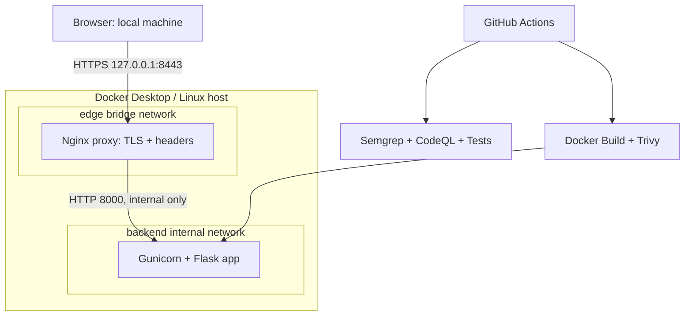

# Lab 11 Architecture

**Trust boundaries:** The host only publishes port 8443 on `127.0.0.1`, not on public interfaces. The Flask backend has no published host port. Both application and proxy containers are non-root with read-only root filesystems and dropped capabilities. TLS uses a **temporary self-signed certificate** kept in a local Docker volume, not in Git.

**Production changes required:** Trusted public certificate and managed key storage, real DNS and host firewall, secured server/SSH, continuous monitoring, robust secret provision/rotation, digest pinning, image scanning gates, and appropriate backups. This is a lab deployment, not public production.
